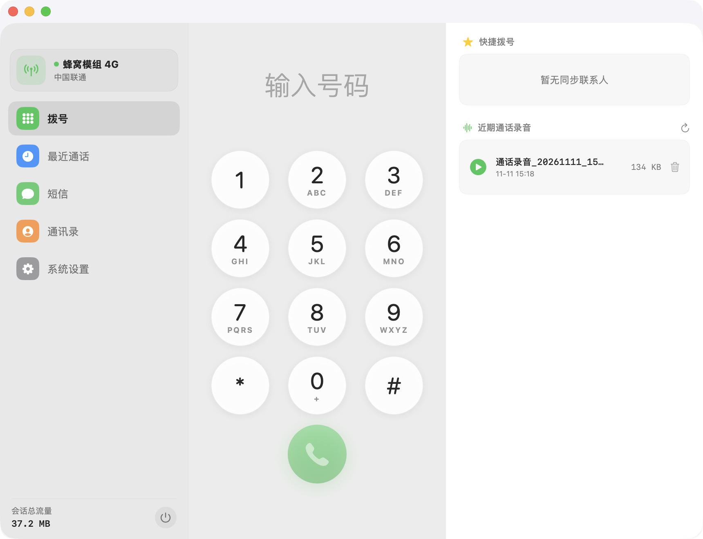

<div align="center">

# 📡 OneModem

### 一张 4G 蜂窝模块 · 插上 Mac / iPad 立即化身免提电话与短信工作站

<p align="center">
  原生系统级通话 · 不改写硬件出厂固件 · 纯软件 TCP 音频桥接 · Mac ↔ iPad 数据双向自动协同
</p>

[](https://github.com/dengboyun/OneModem/releases/latest)
[](https://github.com/dengboyun/OneModem/releases/latest)
[](https://github.com/dengboyun/OneModem/releases/latest)
[-6f42c1?style=flat-square)](https://github.com/dengboyun/OneModem/releases/latest)
[](LICENSE)

<br/>



<p align="center">
  <sub>OneModem macOS 原生桌面界面 · 状态栏信号常驻 · 拟物拨号盘 · 来电录音与短信工作台</sub>
</p>

</div>

---

## ⚡ 核心能力

| 能力 | 说明 | 技术亮点 |
| :--- | :--- | :--- |
| 📞 **系统级免提通话** | 原生来电弹窗通知与状态栏快捷拨号，免插耳机即可直接使用 Mac / iPad / iPhone 麦克风与扬声器 | 纯软件音频链路，无外挂声卡负担 |
| 💬 **短信收发与验证码置顶** | 实时桌面级短信收发，智能识别验证码并以置顶卡片弹出，支持一键复制 | 完整号码会话列表，消息即收即达 |
| 🔄 **Mac ↔ 移动端双向协同** | 一根数据线双向无损合并短信与通话记录，跨端使用无缝流转 | 只增不减并集算法，墓碑标记防幽灵复活 |
| 💾 **数据与存储原生管理** | 100% 遵循 Apple HIG 规范，支持四色存储占用统计、快照临时安全导出与 A/B 隐私擦除防误删 | 临时目录自动清理，杜绝跨端数据事故 |
| 📱 **iPhone 移动形态全面解锁** | 完整支持 iPhone (iOS 16.1+) 侧载运行，支持系统级 CallKit 与紧凑单栏自适应布局 | 覆盖老款 Lightning 与新款 Type-C 机型 |
| 🎧 **无损硬件声卡架构** | 完整保留模组原厂 UAC 声卡描述符，通过 TCP 7580 实时传输 PCM 语音流 | 硬件通道零占用，100% 保持出厂兼容 |
| 🔔 **锁屏网络保活感知** | 模组底层定期注入网络保活报文，防止系统锁屏挂起虚拟网卡 | 锁屏状态依然能秒级响应来电与短信 |
| 🛟 **100% 可逆出厂重置** | 纯软件参数层交互，绝不刷入任何第三方修改版 ROM | 一行指令随时无损恢复无人机原厂飞控状态 |

---

## 🤖 让 AI 助手帮我一键安装（AI-First Prompt）

> **省时秘诀**：如果你正在使用 **Claude Code**、**Cursor**、**Windsurf**、**Antigravity** 或其他本地 AI 编程助手，可以直接将以下提示词整段复制并发送给 AI，它会自动为你完成下载、安全校验与安装部署：

```markdown
请帮我自动下载并安装 OneModem macOS 客户端，并建立安全出厂备份：
1. 从 GitHub 官方发布页下载最新的 macOS 安装包：
   curl -L -o /tmp/OneModem-Universal.dmg https://github.com/dengboyun/OneModem/releases/latest/download/OneModem-Universal.dmg
2. 下载对应的 SHA256 校验和文件并验证完整性：
   curl -L -o /tmp/SHA256SUMS.txt https://github.com/dengboyun/OneModem/releases/latest/download/SHA256SUMS.txt
   (cd /tmp && shasum -a 256 -c SHA256SUMS.txt --ignore-missing)
3. 校验通过后，自动挂载 DMG 并安装至系统的 Applications 文件夹：
   hdiutil attach /tmp/OneModem-Universal.dmg -nobrowse -quiet
   cp -R /Volumes/OneModem/OneModem.app /Applications/
   hdiutil detach /Volumes/OneModem -quiet
   rm -f /tmp/OneModem-Universal.dmg /tmp/SHA256SUMS.txt
4. 清理隔离属性并启动应用：
   xattr -dr com.apple.quarantine /Applications/OneModem.app 2>/dev/null || true
   open /Applications/OneModem.app
5. 提示我初次启动时在弹窗中允许「麦克风」与「通讯录」权限。
6. 【硬件安全保险绳 · 优先备份】：若已通过 USB 连接 4G 模组，自动帮我导出原厂寄存器快照并保存至本地，以便日后随时 100% 恢复无人机出厂状态：
   mkdir -p ~/Documents/OneModem/backups
   curl -s http://127.0.0.1:7575/api/status > ~/Documents/OneModem/backups/factory_status.json 2>/dev/null || true
   curl -s -X POST http://127.0.0.1:7575/api/at -H "Content-Type: application/json" -d '{"command":"AT+QCFG=\"usbcfg\"?"}' > ~/Documents/OneModem/backups/factory_usbcfg.txt 2>/dev/null || true
```

---

## 📥 手工快速下载与校验

| 平台 / 架构 | 下载通道 | 格式与大小 | 安装建议 |
| :--- | :--- | :--- | :--- |
| 🍏 **macOS**<br/><sub>(Apple Silicon + Intel 通用)</sub> | [⬇️ **下载 OneModem-Universal.dmg**](https://github.com/dengboyun/OneModem/releases/latest/download/OneModem-Universal.dmg) | `.dmg`<br/>`~5.9 MB` | 双击挂载后拖入 `Applications` 即可运行 |
| 📱 **iPadOS / iOS**<br/><sub>(iPhone + iPad 原生 arm64)</sub> | [⬇️ **下载 OneModem.ipa**](https://github.com/dengboyun/OneModem/releases/latest/download/OneModem.ipa) | `.ipa`<br/>`~4.5 MB` | 支持 TrollStore / AltStore / Sideloadly 侧载 |

> 🔐 **防伪指纹（SHA-256 Checksum）**：
>
> | 交付文件 | SHA-256 校验码 |
> | :--- | :--- |
> | `OneModem-Universal.dmg` | `e71f9340872bb49553617cf89c1debe67e5cb760b3357f5d8c4025b280ccf6ad` |
> | `OneModem.ipa` | `40a85941a8f6a0358daa4daf582fbdb5355e62f0b62d8bcddd66df7732ab7620` |
>
> *本地校验命令：`shasum -a 256 <下载的文件名>`*

---

## 🚀 快速上手流程


### 1. Mac 端初次配置（30 秒就绪）
1. 双击打开 `OneModem-Universal.dmg`，将 **OneModem** 拖拽入 `Applications` 目录；
2. 在「启动台」中打开 OneModem，首次启动系统会弹出授权请求：
   - **麦克风**：通话时拾音（必需）
   - **通讯录**：来电与短信显示联系人姓名（推荐）
3. 允许后，macOS 顶部菜单栏将出现绿色蜂窝信号图标，点击即可展开快速拨号盘。

### 2. iPad / iPhone 端安装与硬件转接
根据您的设备系统环境，选择以下任意一种方式侧载 `OneModem.ipa`：
- **方案 A · TrollStore 巨魔商店（推荐 · 永久免续签）**：  
  在「文件」App 中长按 `OneModem.ipa` ➔ 分享 ➔ 选择 **Install with TrollStore** 即可。
- **方案 B · 个人 Apple ID 免费自签（7 天循环）**：  
  通过数据线连接电脑，使用 **AltStore** 或 **Sideloadly** 签名安装。
- **方案 C · 容器化直载**：  
  使用 **LiveContainer** 导入 `OneModem.ipa` 零签名免证书运行。

> ⚠️ **iPhone 硬件连接重要提示**：
> - **Lightning 接口机型（iPhone 14 及以前，如 iPhone X / 11 / 12 / 13 / 14）**：蜂窝模组瞬时电流可达 1A~2A，机身直插会因供电不足弹出「配件消耗电量过多」。**必须搭配带独立供电口的官方 / MFi 认证 OTG 相机转接套件**；
> - **USB-C 机型（iPhone 15 及以后）**：支持标准 Type-C 数据线直插使用，长时间通话建议关注设备电量。

### 3. Mac ↔ iPad 数据协同
1. 使用 USB-C 数据线将 iPad 连上已运行 OneModem 的 Mac；
2. 打开 Mac 端 OneModem ➔「系统设置」➔「双端数据协同」；
3. 点击 **「立即同步」**，两台设备中的短信历史与通话记录将自动双向合并，换端使用完全无缝。

---

## 🛟 硬件安全保障：先备份快照 · 随时一键还原

OneModem 采用纯软件参数交互，**绝不刷入任何第三方破解 ROM**，原始大疆基带固件 100% 完整保留。

### 第一步 · 导出出厂参数快照（安全第一铁律）
在初次连接模组时，推荐先在 Mac 终端中备份一份出厂寄存器快照至本地，作为日后的绝对回滚依据：
```bash
# 创建本地安全备份目录并保存出厂状态快照
mkdir -p ~/Documents/OneModem/backups
curl -s http://127.0.0.1:7575/api/status > ~/Documents/OneModem/backups/factory_status.json
curl -s -X POST http://127.0.0.1:7575/api/at \
  -H "Content-Type: application/json" \
  -d '{"command": "AT+QCFG=\"usbcfg\"?"}' > ~/Documents/OneModem/backups/factory_usbcfg.txt
```

### 第二步 · 一键还原出厂无人机模式
当您需要将蜂窝模组插回无人机使用、转让或遇到配置异常时，在终端运行以下指令，模组将立即 100% 恢复为出厂无人机飞控状态：
```bash
# 一键恢复原厂 USB 复合接口与出厂声卡状态（无人机即插即飞）：
curl -X POST http://127.0.0.1:7575/api/at \
  -H "Content-Type: application/json" \
  -d '{"command": "AT+QCFG=\"usbcfg\",0x2CA3,0x4006,1,1,1,1,1,0,0"}'
```

---

## ❓ 常见问题排查 (FAQ)

<details>
<summary><b>Q1: 为什么免提通话时听不到对方声音或麦克风无声？</b></summary>
<br/>
请检查系统权限设置：
前往 Mac <b>「系统设置」➔「隐私与安全性」➔「麦克风」</b>，确保 <b>OneModem</b> 处于开启勾选状态。
</details>

<details>
<summary><b>Q2: 模组拔出或休眠断开后，后台会不会狂刷日志或死循环卡死？</b></summary>
<br/>
不会。OneModem 内置了工业级智能指数退避重连机制（1s ➔ 2s ➔ 4s ... 最大 30s）。当硬件断开时会自动静默降频待命，CPU 占用率归零，绝不拖慢系统。
</details>

<details>
<summary><b>Q3: 插上 4G 模组后，电脑原本的 Wi-Fi 上网会受到影响吗？</b></summary>
<br/>
不会。系统默认会按照网络优先级路由。如果需要优先保证 Wi-Fi 走宽带流量，可以在 Mac <b>「系统设置」➔「网络」➔ 右下角「…」➔「设定服务顺序」</b>中，将 Wi-Fi 拖到最顶部即可。
</details>

---

## 🔐 隐私与安全承诺

- **100% 本地存储**：软件不搭建任何外部中心化服务器，您的短信记录、通话历史及联系人全部留存在本机磁盘中。
- **敏感信息自动掩码**：运行时日志对手机号、验证码、IMEI 等敏感信息实行严格掩码脱敏。
- **本地回环隔离**：底层控制接口严格绑定至 `127.0.0.1` 本地回环地址，不对外部网络开放。

---

## 🤝 项目渊源与致谢（Acknowledgments & Lineage）

OneModem 的诞生与演进，深深得益于开源社区与极客先行者的无私探索。在此真诚致谢以下奠基者与早期开源项目：

- **开源上游基础**：**[wzz04810-debug/DJOneHub](https://github.com/wzz04810-debug/DJOneHub)**  
  由 **Mirror / 小吴（[@小吴折腾AI](https://xhslink.cn/o/70Ecv4YqEvk)）** 主导整理，首创了基于 TCP 7580 网络 PCM 的机身扬声器/麦克风免提语音链路，为 QDC507 模块通信提供了开创性的软硬件协同原型。
- **原始开拓与奠基**：**[@JieDen](https://github.com/JieDen)**  
  大疆 4G 蜂窝模块（QDC507 / 百旺）在 macOS 与 iOS 端通信改造的原始架构奠基人。
- **社区核心贡献者**：感谢 **Jamie（@没错jamie就是我）** 与 **XUXU** 在模块驱动调试、连接模式与工具链上的关键支持。
- **底层语音参考**：**[moluncn/mavo](https://github.com/moluncn/mavo)**  
  高通 MDM9607 基带 VoLTE PCM 音频路由 helper 的原始参考实现。

---

### 🚀 取长补短 · OneModem 的代际演进

OneModem 在上述开源原型的坚实基础上，针对日常长期高频使用，进行了全面的**工业级重构与生产化交付**：

| 核心维度 | 上游早期探索方案 | OneModem 现役系统（代际升级） |
| :--- | :--- | :--- |
| **跨端数据协同** | 双端数据各自孤立，历史记录无法互通 | **独创双端数据协同引擎**<br/>通过 USB 局域链路实现 Mac ↔ iPad 短信与通话记录一键双向合并，内置墓碑防幽灵复活机制 |
| **运行模式切换** | 依赖手动在界面切换连接模式，重新枚举容易导致失联 | **底层固化全功能自适应**<br/>彻底剔除破坏性手动切换按钮，硬件级热插拔即插即用（拔下换插另一端 3~5 秒自适应就绪） |
| **网络路由保护** | 模块网卡可能抢占 Wi-Fi 默认网关消耗 SIM 流量 | **RoutingGuard 路由隔离保护**<br/>主流量强制走电脑 Wi-Fi，4G 模组仅负责语音与短信，做到蜂窝 0 额外宽带消耗 |
| **出厂安全闭环** | 缺乏标准化的快照与防呆还原 | **先备份出厂快照 + 一行指令 100% 还原**<br/>随时可无损恢复为无人机原厂出货飞控状态，保障硬件资产安全 |
| **开箱交付体验** | 散落源码与未签名散包，部署门槛高 | **生产级 Universal DMG + 优化版 IPA**<br/>开箱即用，支持 AI 助手一键安装提示词自动化部署 |

---

## 📄 许可协议

本项目为**个人免费版软件（Freeware）**，仅供合规技术研究与日常体验使用。详情请参阅 [`LICENSE`](LICENSE)。
