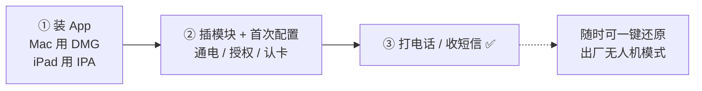
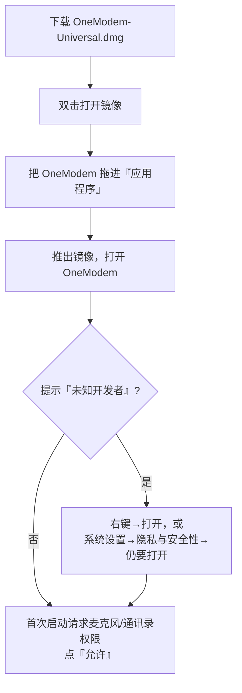
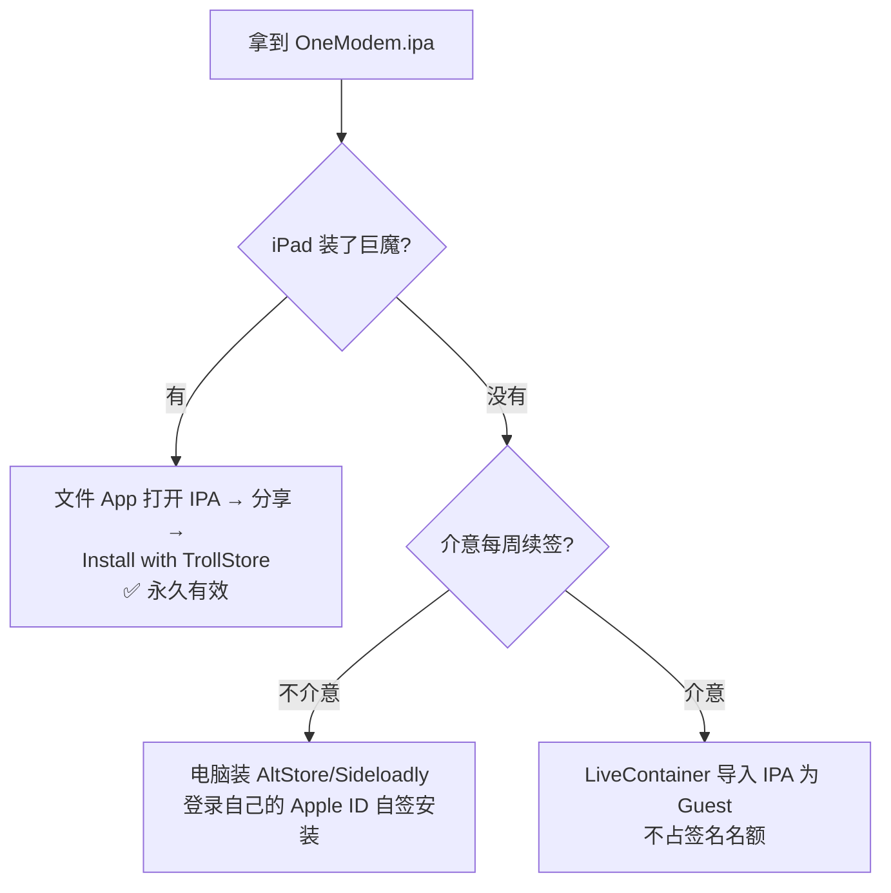
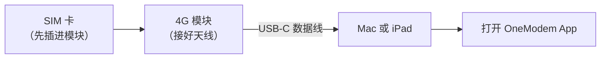

# 📡 OneModem 快速上手与首次配置图文指南

> **给谁看**：第一次接触 OneModem 的小白用户。照着做，10 分钟让一张 4G 模块变成 Mac / iPad 上的"免提电话 + 短信机"。
> **OneModem 是什么**：把 4G 蜂窝模块（QDC507 / MDM9607 等标准模组）通过 USB-C 插到 Mac 或 iPad，就能打电话（免耳机）、收发短信 / 验证码、看信号。**不刷固件、不改模块出厂设置**（除非你自己主动一键还原）。
> **版本**：v2.0 ｜ **适用**：macOS 13.0+（Intel / Apple Silicon 通用）、iPadOS 16.1+

---

## 🧭 三步走总览



> [!NOTE] 你现在需要准备什么
> ① 一台 Mac 或 iPad；② 一个 4G 蜂窝模块（含天线、一张能上网的 SIM 卡）；③ 一根 USB-C 数据线（能传数据，不是只能充电）；④ 模块说明书里的 AT 维护口（一般是 USB 口，用于应急还原）。

---

## 第一步 · 安装 App

### 🍎 Mac 用户：双击 DMG（30 秒）



**图文步骤：**

1. 双击 `OneModem-Universal.dmg`，会弹出一个窗口。
   > 📷 *[配图位 1：DMG 挂载窗口，显示 OneModem.app 与"应用程序"文件夹图标，箭头示意拖拽]*
2. 把蓝色的 **OneModem** 图标拖进右边的「应用程序」文件夹。
3. 在「启动台」或「应用程序」里打开 OneModem。
   - 如果 macOS 提示"无法打开，来自未知开发者"：在图标上**右键 → 打开 → 打开**；或到 **系统设置 → 隐私与安全性 → 仍要打开**。
4. 首次启动会弹出两个权限请求——**麦克风**（打电话用）、**通讯录**（显示来电姓名用），都点 **允许**。

> [!WARNING] 麦克风不给 = 通话没声音
> 如果不小心点了"不允许"，去 **系统设置 → 隐私与安全性 → 麦克风** 里把 OneModem 打开，然后重启 App。

> ✅ **Intel 还是 Apple Silicon 都能用**：这个 DMG 是 Universal 通用版（同时含 x86_64 + arm64 两种芯片的原生代码），不用纠结你的 Mac 是哪款。

### 📱 iPad 用户：选一种方式装 IPA

iPad 不能像 Mac 那样直接双击安装，需要三选一。**新手推荐 TrollStore（巨魔）**，一次安装永久有效、不用每周续签。

| 方式 | 适合谁 | 有效期 | 难度 |
| :--- | :--- | :--- | :--- |
| 🟢 **TrollStore（巨魔）** | 已装巨魔 / 想省心 | 永久 | ⭐ 最简单 |
| 🟡 **AltStore / Sideloadly** | 没巨魔、能接受每周续签 | 7 天 | ⭐⭐ |
| 🔵 **LiveContainer** | 签名名额已满 / 不想用个人证书 | 跟随宿主 | ⭐⭐⭐ |



**方式 A · TrollStore（推荐）**
1. 确认 iPad 已装好 TrollStore（巨魔）。
2. 用「文件」App 找到 `OneModem.ipa` → 点分享 → 选 **Install with TrollStore**。
3. 桌面出现 OneModem，点开即用，永久有效。

**方式 B · AltStore / Sideloadly（7 天自签）**
1. 电脑装 AltStore 或 Sideloadly，登录**你自己的** Apple ID。
2. USB 连 iPad，点"信任此电脑"。
3. 把 `OneModem.ipa` 拖进软件 → 选设备 → 开始安装。
4. ⚠️ **每 7 天要续签一次**（AltStore 可在 Wi-Fi 下自动续；Sideloadly 需手动重签）。
   > 📷 *[配图位 2：Sideloadly 界面，标注"拖入 IPA""选择设备""Start"三处按钮]*

**方式 C · LiveContainer（零签名名额）**
1. iPad 装好 LiveContainer。
2. 把 `OneModem.ipa` 放进 LiveContainer 的 `Documents/`，或用其"导入"功能加载。
3. 首次点卡片会触发约 0.5 秒动态签名，稍等即开。
   > 📷 *[配图位 3：LiveContainer 首页出现 OneModem 卡片的截图]*

---

## 第二步 · 插模块 + 首次配置

### 🔌 硬件连接



> [!WARNING] 三个物理检查（插上没反应先查这里）
> ① SIM 卡**插对方向**、有话费 / 流量；② 天线**拧紧**（没天线搜不到信号）；③ 数据线是**能传数据**的（有些线只能充电）；④ Mac 用户若经拓展坞，确认拓展坞本身供电正常。

### ⚙️ 首次配置（App 里做）

1. **通电等 3~5 秒**：模块上的网络指示灯亮起 / 闪烁。
2. **打开 OneModem**：App 会自动找到模块（状态栏从灰色变绿）。
3. **看状态**：App 首页应显示 **运营商 / 信号格 / VoLTE 就绪**。
   > 📷 *[配图位 4：App 首页状态卡片，标注"运营商""信号强度""VoLTE"位置]*
4. **权限确认**（Mac）：麦克风、通讯录已允许；**（iPad）**：通知、后台网络已允许。
5. **试一下**：拨一个测试号码，或等一条短信，确认免提通话 / 短信正常。

> [!TIP] 状态栏一直转圈 / 显示"检查模块状态：请求超时"？
> 这是 macOS 的路由限制（模块网卡不是默认网关）。OneModem 内置了本地反向代理会自动处理；如果仍不行，确认菜单栏的 OneModem 守护进程在运行，或重启一次 App。

### 🧪 第一次就能用的功能

| 功能 | 怎么试 |
| :--- | :--- |
| 📞 免提打电话 | 拨号盘输入号码 → 拨打 → 直接用 Mac / iPad 机身麦克风和扬声器通话，**不用插耳机** |
| 💬 收短信 / 验证码 | 让朋友发条短信 → App 短信页自动出现，验证码会**置顶大卡片 + 一键复制** |
| 📶 看信号 | 首页状态卡实时显示运营商、频段、信号强度 |
| 🔄 双端同步 | Mac 和 iPad 都用数据线连着时，设置→数据与存储→"双向同步"，短信 / 通话记录自动合并 |

---

## 第三步（重要）· 一键恢复出厂无人机模式

> [!WARNING] 什么时候用 / 用了会怎样
> 想把模块还回无人机、转卖、或配置改乱了想恢复原厂时用。**执行后 UAC 声卡消失，OneModem 的免提能力会暂时失效**，模块回到没改造过的出厂状态。👉 **执行前务必先备份**（见下方"备份保险绳"）。

### 🛟 备份保险绳（强烈建议先做）

```bash
# Mac 上打开"终端"，粘贴执行，把模块出厂参数存到本地（会生成几个 txt 文件）
curl -s -X POST http://127.0.0.1:7575/api/at -H "Content-Type: application/json" -d '{"command":"AT+QCFG=\"usbcfg\"?"}'
curl -s -X POST http://127.0.0.1:7575/api/at -H "Content-Type: application/json" -d '{"command":"ATI"}'
```

### 🔁 方式 A：模块在线时（正常情况）

在 Mac「终端」执行这一条即可（适用于 QDC507 / Baiwang，VID `2ca3` / PID `4006`）：

```bash
curl -s -X POST http://127.0.0.1:7575/api/at \
  -H "Content-Type: application/json" \
  -d '{"command":"AT+QCFG=\"usbcfg\",0x2CA3,0x4006,1,1,1,1,1,0,0"}'
```

执行后模块**自动重启**，USB 和声卡恢复成出厂纯净状态。

### 🆘 方式 B：模块"变砖"、连不上 App 时（断网自救）

如果 7575 / 7580 端口都不通了，用 USB 转串口线直连模块的 **AT 维护口**（常见 `/dev/ttyUSB2`）：

```bash
printf 'AT+QCFG="usbcfg",0x2CA3,0x4006,1,1,1,1,1,0,0\n' \
  | timeout 6 socat -T 3 - /dev/ttyUSB2,crnl
```

> [!NOTE] 记住这句口诀就够了
> 一串数字里**倒数第二位从 `1` 改回 `0`** = 关掉 UAC 声卡 = 回到无人机出厂模式。反过来把它设回 `1` 就能重新开启 OneModem 免提。
> ⚠️ 其它型号模块（如 EC200）出厂值不同，**别照抄这串数字**，要用你自己备份的出厂快照值。

> 📷 *[配图位 5：终端执行还原命令 + 模块重启后系统重新枚举出"未知 USB 设备"的对照截图]*

---

## ❓ 常见问题速查

| 现象 | 一句话解决 |
| :--- | :--- |
| 通话没声音 | 检查麦克风权限；确认**通话中**（待机时语音通道本来就是关的）；别强杀后台 |
| 状态栏"最近通话"空，但主面板有 | 已修复：两处统一读本地记录；升级到最新版即可 |
| 短信通知点进去跳到设置页 | 已修复：短信通知点进去直达对应号码的聊天；升级到最新版 |
| 室内有 Wi-Fi 却跑手机流量 | 设置里开"0 流量"：IPv4 手动、网关留空、IPv6 关闭 |
| 模块拔掉后风扇狂转 / 日志刷屏 | 已内置离线退避（最多 30 秒查一次），升级到最新版 |
| iPad 签名 7 天到期 | 续签 LiveContainer / AltStore 宿主；或改用巨魔永久签 |
| 用了还原命令后 OneModem 没声卡了 | 正常，UAC 被关了；按你备份的出厂快照把第 8 位设回 `1` 重新激活 |

---

## 🔐 隐私与安全（我们帮你把关了）

- ✅ **不收集**你的短信、通话、联系人、位置；所有数据只存在你自己的设备本地。
- ✅ 日志里的手机号会**自动打码**（只留后 4 位）；导出 CSV 时会提示"含明文，请妥善保管"。
- ✅ 代码里**没有任何写死的** IMEI / 手机号 / Apple ID / 个人路径；通过四维安全审计。
- ✅ 仅监听本地 `127.0.0.1`，不会把 AT 调试口暴露到局域网。

---

## 📥 下载与校验

| 文件 | 说明 | SHA-256 |
| :--- | :--- | :--- |
| `OneModem-Universal.dmg` | Mac 通用安装包（Intel + Apple Silicon） | `8e92d2b122ed918d93897f09be213b89a0fb77653b4d029dc79493fe298bfda5` |
| `OneModem.ipa` | iPad 通用安装包装（TrollStore / 自签 / LiveContainer 共用） | `75d389839f5794662cbe719465245a5181598f0192d49ea6a33d982369fe79aa` |

> 校验方法（Mac 终端）：`shasum -a 256 OneModem-Universal.dmg`（或 `OneModem.ipa`），与上表比对一致即可。

> [!NOTE] 关于 iPad 包
> `OneModem.ipa` 是**未签名的中性包**，供巨魔直装 / 个人证书自签 / LiveContainer 侧载使用。它不含任何开发者的账号或配对文件——签名时用的是**你自己的** Apple ID 或巨魔环境。
